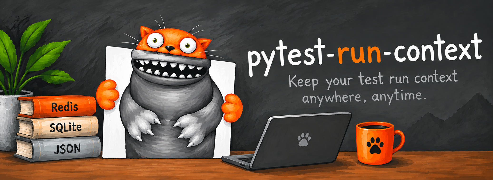
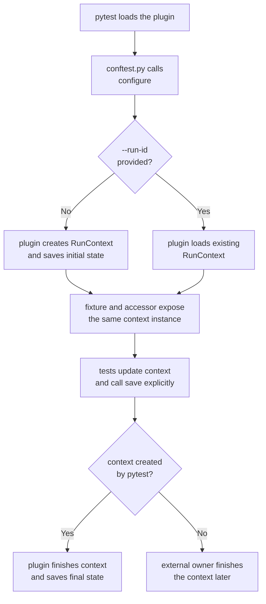
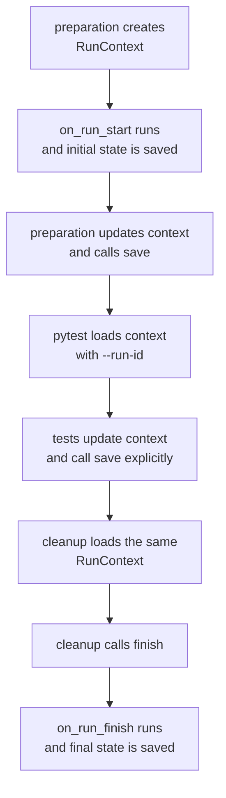

<p align="center">
  
</p>

[](https://pypi.org/project/pytest-run-context/)
[](LICENSE)

# pytest-run-context

Minimal pytest plugin: one mutable, session-wide Pydantic context, explicit persistence and pluggable Storage.

## Installation

Add the plugin to a uv project:

```bash
uv add pytest-run-context
```

Once installed, pytest loads the plugin automatically through its `pytest11`
entry point. Run the consuming project's tests as usual:

```bash
uv run pytest
```

Install the optional Redis backend with `uv add 'pytest-run-context[redis]'`.

## Usage



`conftest.py`:

```python
from typing import Optional

from pydantic import Field
from pytest_run_context import BaseCustomContext, configure
from pytest_run_context.storage import SQLiteStorage


class ProjectContext(BaseCustomContext):
    environment: str = "dev"
    stand_id: Optional[str] = None
    service_versions: dict[str, str] = Field(default_factory=dict)


def pytest_configure(config):
    configure(config, context_model=ProjectContext, storage=SQLiteStorage("runs.db"))
```

`tests/test_example.py`:

```python
from pytest_run_context import get_run_context


def test_context(run_context):
    run_context.custom.stand_id = "stand-01"
    assert get_run_context() is run_context
    run_context.save()
```

Without `--run-id`, pytest creates a context with a generated UUID and owns its
lifecycle. Creation calls `on_run_start()`, persists the initial state, and
pytest calls `finish()` when its session ends. `finish()` calls
`on_run_finish()`, sets `finished_at`, and persists both objects.

Passing `--run-id` means loading an existing active context; it never chooses
an ID for a new context. Pytest preserves fields prepared by another process
and leaves the context unfinished for its external lifecycle owner. It does not
automatically save changes at session completion: tests, fixtures, or other
user code must call `run_context.save()` explicitly. An unknown or already
finished ID causes a usage error before tests execute. A consuming project can
require `--run-id` in its own hook:

```python
import pytest


def pytest_configure(config):
    if not config.getoption("--run-id"):
        raise pytest.UsageError("Missing --run-id. Run environment preparation first.")
    configure(config, context_model=ProjectContext, storage=SQLiteStorage("runs.db"))
```

## Creating and loading outside pytest



An external script can prepare a persistent context without a pytest
`Config`:

```python
from pytest_run_context import RunContext
from pytest_run_context.storage import SQLiteStorage

storage = SQLiteStorage("runs.db")
try:
    context = RunContext.create(
        context_model=ProjectContext,
        storage=storage,
    )
    context.custom.environment = "prepared"
    context.save()
    print(context.info.run_id)
finally:
    storage.close()
```

The subsequent pytest process configures the same backend and runs with the
printed ID:

```bash
pytest --run-id=<generated-run-id>
```

After pytest and environment cleanup, the creating workflow reloads and
finishes the context:

```python
storage = SQLiteStorage("runs.db")
try:
    context = RunContext.load(
        run_id=run_id,
        context_model=ProjectContext,
        storage=storage,
    )
    context.finish()
finally:
    storage.close()
```

`create()` accepts an optional explicit `run_id`; storage atomically rejects a
duplicate with `RunAlreadyExistsError`. `load()` never creates or overwrites a
run. It raises `RunNotFoundError` for a missing run and
`InvalidStoredRunError` for invalid persisted data. Loading a finished run is
allowed for inspection, but calling `finish()` again raises
`RunAlreadyFinishedError`.

`save()` explicitly writes the current snapshot without invoking lifecycle
hooks. Mutable custom values are visible immediately to code sharing the same
in-memory context, but are not persisted merely because a pytest session ends.
`create()` persists the initial state and `finish()` persists the final state.
`on_run_start()` runs only during creation. Loading, including pytest loading
through `--run-id`, does not run it again. The owner that created the logical
run is responsible for calling `finish()`: pytest owns contexts it creates,
while an external preparation workflow owns contexts pytest loads.

SQLite, JSON, and Redis can share a context between processes when every
process uses the same backend configuration. Independent `MemoryStorage`
instances cannot. SQLite and JSON data never expire automatically; Redis TTL
is configurable and renewed on every write. JSON storage is intended for
sequential, single-process access. Storage passed to standalone APIs remains
owned by the caller and must be closed by it.

Without `configure()`, the plugin uses in-memory storage and the base custom
context. The plugin does not collect test results or save after individual
tests. `get_run_context()` uses `ContextVar`; new threads do not inherit it
automatically.

## Examples

The [`examples/`](examples/README.md) directory contains runnable scenarios.
Each example focuses on one decision so that storage behavior and context
ownership can be understood independently:

- [`memory_storage/`](examples/memory_storage/README.md) shows the smallest
  storage setup when context data is needed only inside one process.
- [`json_storage/`](examples/json_storage/README.md) shows human-readable,
  file-based persistence with one JSON document per run.
- [`sqlite_storage/`](examples/sqlite_storage/README.md) shows durable local
  persistence in a single SQLite database.
- [`redis_storage/`](examples/redis_storage/README.md) shows shared persistence
  with configurable expiry and connection retries in an externally managed
  Redis service.
- [`standalone/`](examples/standalone/README.md) focuses on the lifecycle in
  which pytest creates, saves, and finishes the context itself.
- [`external_preparation/`](examples/external_preparation/README.md) shows a
  multi-process workflow in which an external orchestrator owns the context
  lifecycle while pytest loads and updates that context.

Configurable backend examples use the `PYTEST_RUN_CONTEXT_*` variables listed
in [`.env.example`](.env.example).

## pytest-xdist

With `pytest -n N`, the controller creates one logical run and passes its
`run_id` to every worker through xdist's `workerinput`. Each worker loads its
own in-memory `RunContext` instance from the configured Storage. At session
completion the controller reloads the latest stored snapshot and finishes the
run once. Failed tests do not prevent this normal session finalization.

With `pytest -n N --run-id=ID`, the controller and workers load the externally
created run. None of them automatically saves or finishes it; the external
lifecycle owner remains responsible for `finish()`.

Explicit worker `save()` calls write complete snapshots. Concurrent changes
from different workers are not merged, and the last completed write wins.
xdist therefore requires a Storage backend shared by all processes, such as
SQLite or Redis. `MemoryStorage` is rejected for multi-process runs. JSON
storage remains intended for sequential, single-process access.

Completion cannot be transactional across a user hook and arbitrary storage.
Lifecycle ownership, xdist behavior, and failure limitations are recorded in
[`0002-xdist-lifecycle-and-explicit-save.md`](docs/decisions/0002-xdist-lifecycle-and-explicit-save.md).

## Development with uv

The repository pins Python 3.14 for local development in `.python-version`.
Install the locked default development environment:

```bash
uv sync --locked
```

Tests are separated by purpose:

```text
tests/
├── unit/           # isolated tests using in-memory objects and fakes
└── integration/    # persistent file backends and real Redis
```

Plain pytest runs only unit tests because `tests/unit` is configured as the
default `testpaths` value:

```bash
uv run pytest --strict-markers
```

File-backed SQLite and JSON integration tests use temporary directories and do
not require external services:

```bash
uv run pytest --strict-markers tests/integration/test_file_storage.py
```

Redis integration tests use a disposable `redis:7.4-alpine` Testcontainers
instance and require a running Docker daemon. Install their non-default
development dependency group and run the integration directory explicitly:

```bash
uv sync --locked --group redis-integration
uv run --group redis-integration pytest --strict-markers tests/integration
```

Run the complete quality sequence (unit tests, integration tests, Python
compatibility tests, Ruff lint and format checks, then ty):

```bash
./scripts/ci.sh
```

The complete script requires Docker and network access for the Redis container
image and isolated compatibility environments.

For individual checks:

```bash
uv run pytest --strict-markers python_compatibility_tests
uv run ruff check .
uv run ruff format --check .
uv run ty check
```

To install the plugin in another uv project:

```bash
uv add --editable /path/to/pytest-run-context
# with optional Redis support: uv add 'pytest-run-context[redis]'
```

`uv.lock` pins dependency versions when they can be resolved through the package index. After changing dependencies, run `uv lock` and commit the file. Once installed, the plugin is loaded automatically through the `pytest11` entry point.

## Compatibility

The project supports Python 3.9 through 3.14 and pytest 7.0 or newer. The
compatibility suite tests every supported Python version with the latest compatible
dependencies. It also tests the minimum supported Pydantic and pytest versions on
Python 3.9 through 3.11.

Run the compatibility matrix through pytest:

```bash
uv run pytest --strict-markers python_compatibility_tests -v
```

Or run the standalone shell script:

```bash
./python_compatibility_tests/run_python_compatibility.sh
```
