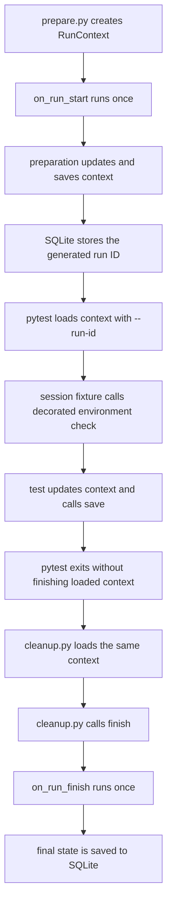

# External environment preparation

This example shows a context shared across three processes. An external
preparation step creates it, pytest loads and updates it, and an external
cleanup step finishes it. The external workflow, rather than pytest, owns the
context lifecycle.

## Context flow



Pytest does not automatically save or finish a context loaded with `--run-id`.
The test therefore calls `run_context.save()` explicitly, and `cleanup.py`
performs finalization after all workflow stages.

## Run the example

From the repository root, install the example dependencies:

```bash
uv sync --locked --group examples
```

Then run the complete workflow in the same shell:

```bash
RUN_ID=$(uv run --group examples python examples/external_preparation/prepare.py)
uv run --group examples pytest --strict-markers examples/external_preparation --run-id="$RUN_ID"
uv run --group examples python examples/external_preparation/cleanup.py "$RUN_ID"
```

`prepare.py` prints the generated run ID after saving the prepared environment.
All three commands use the SQLite database at
`/tmp/pytest-run-context-external-preparation.sqlite3` by default. Override it
consistently for every command by exporting a setting first:

```bash
export PYTEST_RUN_CONTEXT_EXTERNAL_DB=/tmp/my-external-run-context.sqlite3
```

Settings also load the repository's optional `.env` file. In a real
orchestrator, invoke cleanup or equivalent finalization from guaranteed cleanup
logic even when pytest exits unsuccessfully.
