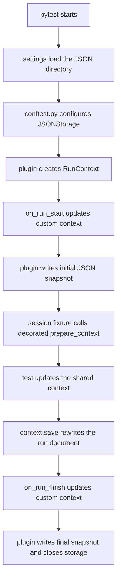

# JSON storage

This example shows persistent, human-readable storage. Each run is written to
its own JSON document, which contains the run ID and separately serialized
`RunInfo` and custom context data.

## Context flow



The JSON filename is a SHA-256 hash of the run ID. JSON storage persists
indefinitely and does not apply a TTL.

## Run the example

From the repository root, install the example dependencies:

```bash
uv sync --locked --group examples
```

Then run the example with its default output directory,
`/tmp/pytest-run-context-example/json`:

```bash
uv run --group examples pytest --strict-markers examples/json_storage
```

To use another directory, set the example-specific environment variable:

```bash
PYTEST_RUN_CONTEXT_JSON_DIRECTORY=/tmp/my-run-context-json \
uv run --group examples pytest --strict-markers examples/json_storage
```

Settings also load the repository's optional `.env` file. Copy `.env.example`
to `.env` if you prefer local file-based configuration; `.env` is ignored by
Git. Do not pass `--run-id` for an ordinary new run.
