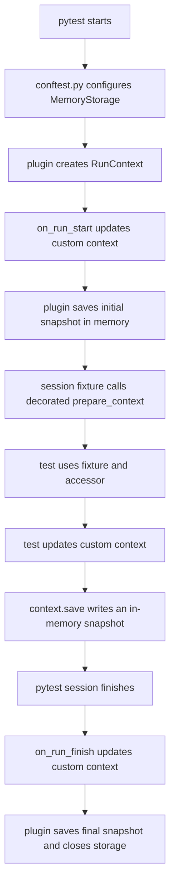

# Memory storage

This example shows the smallest plugin configuration. `MemoryStorage` keeps
snapshots only for the lifetime of its instance, so it is suitable when context
creation and use happen in the same pytest process.

## Context flow



The `run_context` fixture and `get_run_context()` expose the same in-memory
`RunContext` instance during the active pytest session.

## Run the example

From the repository root, install the locked dependencies and run only this
example directory:

```bash
uv sync --locked
uv run pytest --strict-markers examples/memory_storage
```

Do not pass `--run-id`: pytest creates a new context with a generated ID.
Because the storage instance is closed with the session and is not shared with
another process, its saved snapshots are not available after this run.
