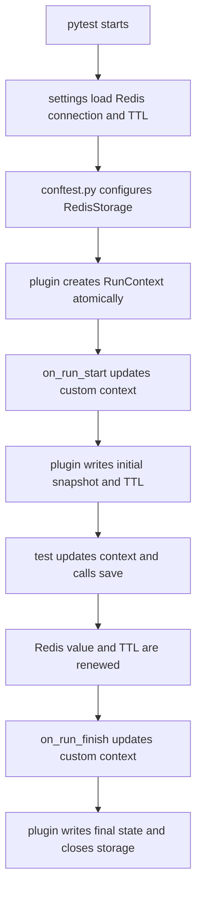

# Redis storage

This example shows persistence in an externally managed Redis service. It is
kept separate because Redis adds optional dependencies, connection settings,
retry behavior, and expiring snapshots.

## Context flow



The TTL defaults to 86,400 seconds, is renewed on every write, and can be
disabled with `PYTEST_RUN_CONTEXT_REDIS_TTL=0`. Creating a run rejects an
existing run ID atomically.

## Run the example

Start Redis separately; this repository does not create or manage a Redis
server. From the repository root, install the example and Redis dependencies:

```bash
uv sync --locked --group examples --extra redis
```

With Redis available at the configured address, run:

```bash
uv run --group examples --extra redis pytest --strict-markers examples/redis_storage
```

The defaults connect to `redis://localhost` on port `6379`, database `0`.
Settings can be supplied through the repository's optional `.env` file or
environment variables with these names:

- `PYTEST_RUN_CONTEXT_REDIS_URL`
- `PYTEST_RUN_CONTEXT_REDIS_PORT`
- `PYTEST_RUN_CONTEXT_REDIS_DB`
- `PYTEST_RUN_CONTEXT_REDIS_USERNAME`
- `PYTEST_RUN_CONTEXT_REDIS_PASSWORD`
- `PYTEST_RUN_CONTEXT_REDIS_TTL`
- `PYTEST_RUN_CONTEXT_REDIS_RETRIES`
- `PYTEST_RUN_CONTEXT_REDIS_BACKOFF_BASE`
- `PYTEST_RUN_CONTEXT_REDIS_BACKOFF_CAP`

Copy `.env.example` to `.env` for local configuration. Keep real credentials
only in that ignored file. Do not pass `--run-id` for an ordinary new run.
