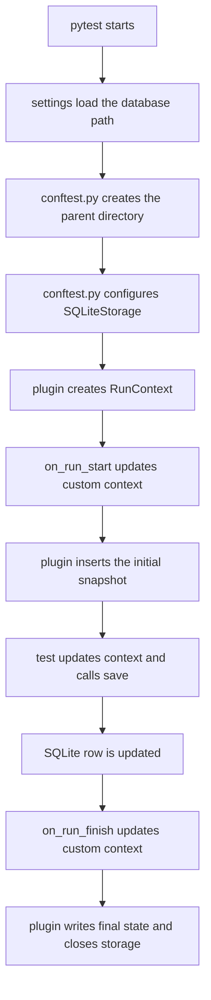

# SQLite storage

This example shows durable local persistence in one SQLite database. It is
useful when contexts must remain available after pytest exits without requiring
an external service.

## Context flow



SQLite storage persists runs indefinitely and does not apply a TTL. Creation
rejects a duplicate run ID instead of overwriting an existing row.

## Run the example

From the repository root, install the example dependencies:

```bash
uv sync --locked --group examples
```

Then run the example with the default database at
`/tmp/pytest-run-context-example/runs.sqlite3`:

```bash
uv run --group examples pytest --strict-markers examples/sqlite_storage
```

To use another database path, set:

```bash
PYTEST_RUN_CONTEXT_SQLITE_PATH=/tmp/my-run-context.sqlite3 \
uv run --group examples pytest --strict-markers examples/sqlite_storage
```

Settings also load the repository's optional `.env` file. Copy `.env.example`
to `.env` if needed; `.env` is ignored by Git. Do not pass `--run-id` for an
ordinary new run.
