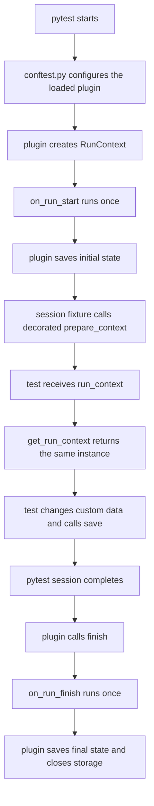

# Standalone pytest execution

This example focuses on lifecycle ownership when pytest is the only
orchestrator. The plugin creates the context at session start and finishes it
at session completion.

## Context flow



`MemoryStorage` is enough here because every lifecycle stage happens in one
process. The focus is not durable persistence, but which component owns
creation and finalization.

## Run the example

From the repository root:

```bash
uv sync --locked
uv run pytest --strict-markers examples/standalone
```

Do not pass `--run-id`. That option means loading an existing context, whereas
this workflow intentionally lets pytest create a new one.
